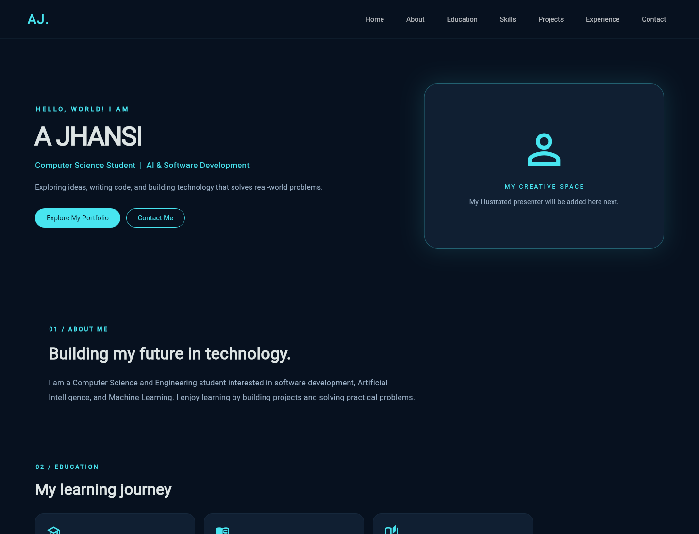
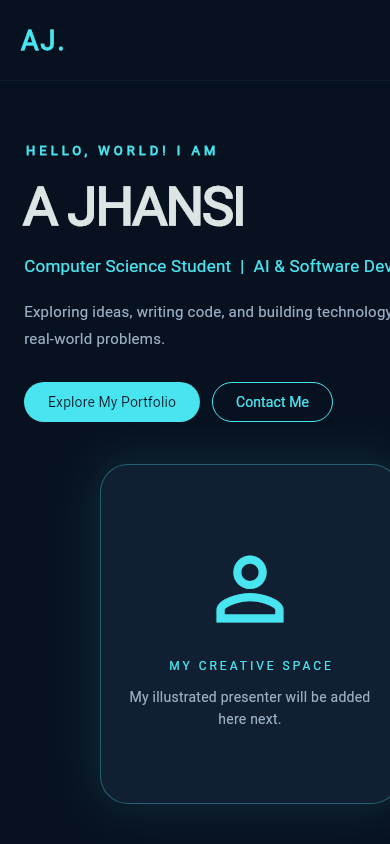

# A JHANSI | Flutter Portfolio

<p align="center">
  <a href="https://ajhansi760.github.io/Jhansiportfolio/">
    
  </a>
  <a href="https://github.com/AJHANSI760/Jhansiportfolio/actions">
    
  </a>
</p>

A responsive personal portfolio built with **Flutter** and **Dart** to showcase my computer science education, technical interests, projects, and learning journey.

## Live Website

**[Visit my portfolio](https://ajhansi760.github.io/Jhansiportfolio/)**

## Portfolio Screenshot

<p align="center">
  <a href="https://ajhansi760.github.io/Jhansiportfolio/">
    
  </a>
</p>

## Mobile Preview

<p align="center">
  
</p>

## About Me

I am a Computer Science and Engineering undergraduate at ACE Engineering College, Telangana, graduating in 2028. My interests include software development, Artificial Intelligence and Machine Learning, computer vision, and innovative technology.

This portfolio is a work in progress and will evolve as I build more projects and strengthen my development skills.

## Portfolio Sections

- **Home:** Introduction and navigation
- **About and Education:** Academic background
- **Skills:** Technical interests and learning
- **Projects:** Selected web, Android, verification, and safety concepts
- **Experience and Achievements:** Internship and student community activities
- **Contact:** Professional profile links

## Featured Projects

| Project | Description | Focus |
| --- | --- | --- |
| V2V Vehicle Collision Alert | A vehicle-to-vehicle safety concept focused on real-time collision warnings | Systems and safety |
| Digital Certificate Verification | A concept for checking certificates using QR codes and database records | Verification and databases |
| Mini E-Commerce Web Project | A web project demonstrating product presentation and shopping UI | HTML, CSS, JavaScript |
| Android Dice Roller | A simple mobile app built while learning Android development | Android and mobile development |

## Technologies

- Flutter
- Dart
- Material Design
- Git and GitHub
- GitHub Actions
- GitHub Pages
- HTML, CSS, and JavaScript for the listed web project

## Run Locally

Install Flutter first and check that it is configured:

```bash
flutter doctor
```

Clone this repository and install its dependencies:

```bash
git clone https://github.com/AJHANSI760/Jhansiportfolio.git
cd Jhansiportfolio
flutter pub get
flutter run -d chrome
```

Build the web version for GitHub Pages:

```bash
flutter build web --release --base-href /Jhansiportfolio/ --no-wasm-dry-run
```

## Deployment

The workflow in `.github/workflows/deploy.yml` builds the Flutter web app and deploys the generated `build/web` files to GitHub Pages when changes are pushed to `main`.

## Repository Structure

```text
Jhansiportfolio/
├── .github/
│   └── workflows/
│       └── deploy.yml
├── assets/
│   └── images/
├── docs/
│   └── screenshots/
│       └── portfolio-home.png
├── lib/
│   └── main.dart
├── test/
├── web/
├── pubspec.yaml
├── pubspec.lock
└── README.md
```

## Connect With Me

- **GitHub:** [AJHANSI760](https://github.com/AJHANSI760)
- **LinkedIn:** [jhansi-a-b1273a327](https://www.linkedin.com/in/jhansi-a-b1273a327/)
- **Portfolio:** [ajhansi760.github.io/Jhansiportfolio](https://ajhansi760.github.io/Jhansiportfolio/)

---

Built with Flutter and Dart.

## Key Features

- Responsive Flutter portfolio for desktop and mobile screens.
- Introduction and education details.
- Technical skills and project showcase.cd "$HOME/Documents/jhansi_portfolio_new" || exit 1
git diff --check || exit 1
git add README.md
git commit -m "Add portfolio setup instructions" || exit 1
git push origin main || exit 1
git rev-list --count HEAD
git status -sb
- Experience and achievements.
- Contact links for GitHub and LinkedIn.

## Quality Checks

Run these commands from the project directory before publishing changes:

```bash
flutter analyze
flutter test
```
## Getting Started

### Prerequisites

- Flutter SDK installed
- Dart SDK included with Flutter
- Git installed

### Setup

1. Clone the repository.
2. Open the project directory in Terminal.
3. Install dependencies:

   `flutter pub get`

4. Run the portfolio locally:

   `flutter run -d chrome`

### Before Contributing

Run `flutter analyze` and `flutter test` to check code quality and verify the widget tests.

Both commands should complete successfully before publishing updates.
## Maintenance Checklist

Before each portfolio update:

- [ ] Review project descriptions and links.
- [ ] Verify GitHub and LinkedIn links.
- [ ] Run `flutter analyze`.
- [ ] Run `flutter test`.
- [ ] Review the portfolio in Chrome at desktop and mobile widths.
- [ ] Commit and push verified changes.
